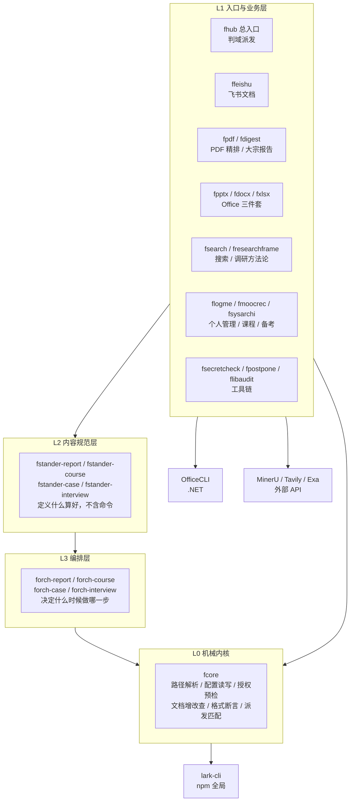
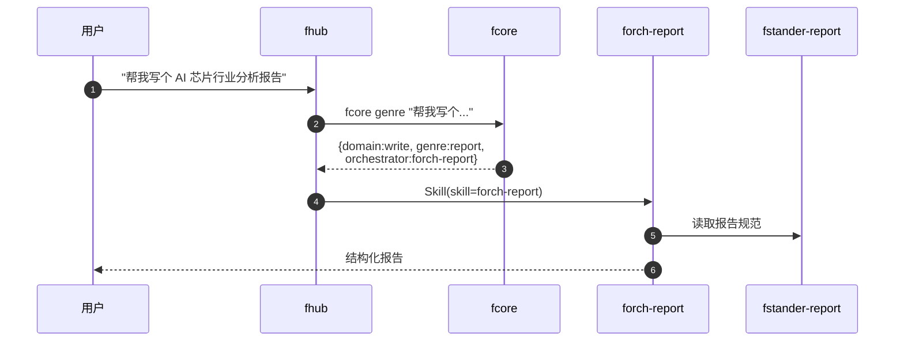
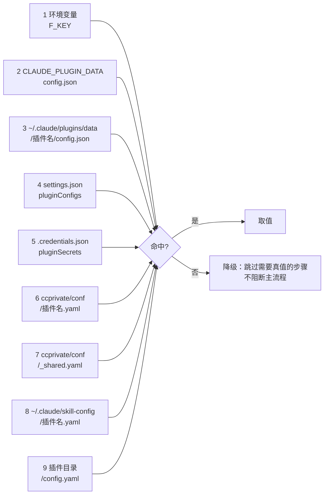

# skill — Claude Code 技能集

> 30 个自建 Claude Code 技能，覆盖飞书文档、撰写系统、PDF 精排、调研搜索、Office 三件套、
> 图表、个人管理与工具链。**分层设计**：机械操作沉到一个内核，业务判断留给技能。
>
> 不确定用哪个技能时说一句"帮我做 X"，`fhub` 会判断并派发。

---

## 快速开始

```bash
# 1. 加 marketplace（一次性）
/plugin marketplace add mengfanchun2017/skill

# 2. 装内核 + 总入口（推荐先装这两个）
/plugin install fcore@mengfanchun2017-skills
/plugin install fhub@mengfanchun2017-skills

# 3. 按需装业务技能
/plugin install ffeishu@mengfanchun2017-skills    # 飞书文档
/plugin install fpdf@mengfanchun2017-skills       # PDF 精排
```

装完直接用自然语言描述需求，不必记技能名：

```
帮我写一份 AI 芯片行业分析报告        → forch-report
把这个 PDF 排到飞书上                → fpdf
总结一下本周工作                     → flogme
画个架构图                          → ffeishu + fdiagram
```

更新：`/plugin marketplace update mengfanchun2017-skills`

---

## 架构总览

五层，越往下越机械，越往上越需要判断。



| 层 | 职责 | 判据 |
|---|---|---|
| **L0 `fcore`** | 一切确定性操作：找配置、读配置、查授权、建/改/查文档、验格式、判该用哪个技能 | 同样输入必得同样输出 |
| **L1 入口与业务** | 判断用户要做什么，执行具体业务流程 | 需要理解意图 |
| **L2 规范** | 定义"一份好的报告/课程/案例长什么样" | 无命令，只有标准 |
| **L3 编排** | 决定做事的顺序与委派（报告分几步、每步产出什么） | 需要进度状态 |

**为什么要分这两层**：L2 管"写得好不好"，L3 管"先做什么后做什么"。合成一个文件的话，
改规范会牵动流程，改流程会碰坏规范。

---

## 派发怎么工作

用户描述需求 → `fhub` 先跑确定性匹配 → 命中就派发，不命中才问。



**匹配规则**（`fcore/lib/genre.sh`）：

1. 完整触发短语命中 → 长词加权（"分析报告" 比 "报告" 分高）
2. 没命中整短语 → **中文二元组词元兜底**：触发词和输入都切成双字词元，重合率 ≥50% 也算命中

第 2 条是关键。注册表里没有"PDF排到飞书"这个说法，但 `PDF` + `飞书` 两个词元能拼出来，
所以口语化描述也能派对。实测 11 条口语化需求全部正确派发。

> ⚠️ 中文分词不能用正则 `[一-鿿]{2,}` —— 贪婪匹配会把"帮我写个行业报告"连成一个词元，
> 永远匹配不到"写报告"。必须用二元组切分。

---

## 目录结构

```
skill/
├── .claude-plugin/
│   └── marketplace.json          # plugin 清单（description 从 SKILL.md 同步）
├── plugins/
│   ├── fcore/                    # L0 机械内核
│   │   ├── bin/fcore             #   CLI 入口（14 条命令）
│   │   ├── lib/                  #   path / lark / genre / fmt
│   │   ├── references/
│   │   │   ├── _boot.sh          #   分发到 30 个 plugin，用于跨插件定位 fcore
│   │   │   └── fcore.default.yaml#   无配置时的内置派发注册表
│   │   ├── SKILL.md
│   │   └── config.yaml.example
│   ├── fhub/                     # L1 总入口
│   │   ├── commands/fhub.md      #   /fhub 斜杠命令
│   │   └── SKILL.md
│   ├── forch-report/            # L3 编排
│   │   ├── references/comm-contract.md
│   │   └── SKILL.md
│   ├── fstander-report/             # L2 规范
│   │   ├── references/           #   4 套模板 + 写作法则
│   │   ├── scripts/report_check.py
│   │   └── SKILL.md
│   └── ...                       # 其余 26 个
├── scripts/
│   └── sync-marketplace.py       # SKILL.md → marketplace.json 同步
├── .github/workflows/check.yml   # CI：frontmatter / config 卫生 / 描述同步
├── docs/adr/                     # 架构决策记录
├── www/                          # 静态展示页（skill.aiagt.dev）
├── CONTRIBUTING.md
└── CHANGELOG.md
```

**每个 plugin 的目录形态**：

```
plugins/<name>/
├── .claude-plugin/plugin.json    # 插件元数据（name/version/description/userConfig）
├── SKILL.md                      # 技能指令（description 是派发的真相源之一）
├── references/                   # 按需加载的长文档（不占常驻 context）
├── scripts/                      # 确定性脚本
├── bin/                          # CLI 入口（仅 fcore）
├── commands/                     # 斜杠命令（仅 fhub）
├── config.yaml.example           # 配置模板（真实值不入库）
└── deps.txt                      # CLI 依赖声明
```

**为什么长文档放 `references/`**：SKILL.md 会整篇进上下文，`references/` 只在模型判断
需要时才读。第二批重构把六个最大技能的 SKILL.md 从 2595 行压到 697 行（-73%），
细节全部移入 `references/`，行为不变。

---

## 配置怎么放（升级不覆盖）

真实值（飞书 token、租户域名、账号）**绝不进公开仓**。运行时按 9 级优先级查找：



| 位置 | 谁在用 | 升级后 |
|---|---|---|
| `ccprivate/conf/<plugin>.yaml` | ccconfig 用户（多机同步） | 保留 |
| `settings.json` pluginConfigs | `/plugin configure` 弹窗填的 | 保留 |
| `${CLAUDE_PLUGIN_DATA}/config.json` | 官方持久目录 | 保留 |
| **`~/.claude/skill-config/<plugin>.yaml`** | **独立用户推荐** | **保留** |
| `<plugin目录>/config.yaml` | 旧通道 | `/plugin update` 整目录替换 → **会丢** |

**为什么第 8 级安全**：`/plugin update` 替换的是
`~/.claude/plugins/cache/<market>/<plugin>/<版本号>/`，
`~/.claude/skill-config/` 在这个范围之外。

```bash
# 写配置（自动落到升级不覆盖的位置）
~/.claude/skills/fcore/bin/fcore conf set tenant_domain your-tenant.feishu.cn

# 查当前从哪个文件读
~/.claude/skills/fcore/bin/fcore conf path tenant_domain

# 排障第一步：打印所有解析路径
~/.claude/skills/fcore/bin/fcore where
```

**配置 vs 用户数据**：

| 类型 | 例子 | 命令 | 落点 |
|---|---|---|---|
| 配置 | 租户域名、wiki 节点 token | `fcore conf get/set` | `skill-config/<plugin>.yaml` |
| 用户数据 | 课程进度、案例索引 | `fcore data` | `skill-config/data/<plugin>/` |

区别：配置是键值对，用户数据是结构自由的文件。

### 没配置也能用

缺配置**不阻断**：技能只做本地能力（抽取、写作、分析、检索），跳过需要飞书的步骤
（归档、Base 写入），并提示去哪儿填。`fhub` 的派发也不依赖任何配置
（无配置时用内置注册表 `fcore/references/fcore.default.yaml`）。

---

## 全部技能

### L0 · 机械内核

| Plugin | 说明 |
|---|---|
| `fcore` | 路径解析、配置读写、lark-cli 授权预检、文档增改查上传、格式断言、派发匹配。**其他技能不重写这些命令，一律调它** |

`fcore` 的 14 条命令：

| 命令 | 作用 |
|---|---|
| `fcore auth` | 飞书授权预检（0=可用 1=未装 2=未配置） |
| `fcore conf get/set/path/require` | 配置读写与诊断 |
| `fcore data / data-ls` | 用户数据文件路径 |
| `fcore genre / genres` | 判该用哪个技能 |
| `fcore fmt-xml / fmt-md` | 格式断言（H1 配色/表格 colgroup/引用/文献数） |
| `fcore doc create/get/ids`、`upload`、`search` | 文档操作固定参数模板 |
| `fcore where` | 打印全部解析路径 |
| `fcore doctor` | 体检：CLI 工具、授权、配置（只报告） |
| `fcore fix` | 体检 + 自动修复（缺啥装啥，修完复检） |
| `fcore office <args>` | OfficeCLI 包装 |

### L1 · 入口与业务

| Plugin | 说明 |
|---|---|
| `fhub` | **总入口** — 判断需求属哪个技能并派发，用户不必记技能名 |
| `ffeishu` | 飞书文档编排（wiki/表格/白板、整合/拆分/转换/对比） |
| `fdiagram` | 飞书画板（Mermaid/PlantUML：架构/流程/时序/ER/类/甘特/思维导图） |
| `fpptx` | PPT / 飞书 Slides（OfficeCLI + 6 套设计主题） |
| `fdocx` | Word .docx（OfficeCLI：模板/样式/表格/图片/目录） |
| `fxlsx` | Excel .xlsx（OfficeCLI：公式/图表/条件格式/透视表） |
| `fpdf` | PDF 精排上飞书（表格列宽/行内公式/高清图/参考文献） |
| `fdigest` | 大宗报告阅读与归档（结构化抽取 → 段落检索 → 分层归档） |
| `fsearch` | 搜索统一原语（中文→MiniMax、英文→Tavily，耗尽切 Exa） |
| `fresearchframe` | 4 领域研究方法论（customer/generic/market/technical） |
| `flogme` | 个人管理（OKR/Worklog/Reflect/SUM，飞书 Base） |
| `fmoocrec` | MOOC 课程推荐（QS 课程体系 + 学习路径） |
| `fsysarchi` | 系统分析师备考（暗号 `archi` 触发） |
| `fmashwork` | AI 图生 3D → 拓竹打印 |
| `fsecretcheck` | 密钥泄露检查（工作树 + git 历史） |
| `fpostpone` | 定时延迟执行（`18点运行 /transliter "x.zip"`） |
| `flibaudit` | 仓库全面审计 |
| `fsyncdoc` | 源码文档同步 |
| `fllmpack` | LLM 预设导出/导入（不含 key） |
| `fskillcreat` | Skill 开发脚手架 |

### L2 · 内容规范

| Plugin | 说明 |
|---|---|
| `fstander-report` | 报告写作（4 套模板：研究/分析/对比/方案 + 数据分级/引用纪律/判断主线） |
| `fstander-course` | 课程文档内容规范 |
| `fstander-case` | 案例库内容规范（Base schema + 起名规则 + 正文模版） |
| `fstander-interview` | 面试准备内容规范 |

### L3 · 编排

| Plugin | 说明 |
|---|---|
| `forch-report` | 报告生成（JSON/大纲/自由素材 → 结构化 markdown，3 种输入模式） |
| `forch-course` | 系列课程创作（从零创作 / 现有材料课程化） |
| `forch-case` | 案例库编排（飞书 wiki 三层 + Base 元数据） |
| `forch-interview` | 面试准备（岗位认知 → 专业能力 → 未来工作思路） |

### 旧入口（建议改走 fhub）

| Plugin | 说明 |
|---|---|
| `forch` | 撰写系统路由层。职能已并入 `fhub` + `fcore genre`，保留只为不打断既有习惯 |

---

## 外部依赖

| 依赖 | 用途 | 装法 |
|---|---|---|
| `lark-cli` | 所有飞书操作 | `npm install -g @larksuite/cli` → `lark-cli auth login` |
| OfficeCLI | PPT/Word/Excel 原生生成 | `curl -fsSL https://d.officecli.ai/install.sh \| bash`（需 libicu） |
| `uv` | fpdf/fdigest 的 Python 运行器 | `curl -LsSf https://astral.sh/uv/install.sh \| sh` |
| MinerU API | PDF 结构化解析 | mineru.net 建 token → `fcore conf set mineru.token <token>` |

各 plugin 用 `deps.txt` 声明 CLI 依赖。技能首次调用时检测可用性，缺失则提示装法，
不自动安装（公开仓不放安装脚本）。

**飞书 lark-\* skill 不用装**：`lark-cli` 是 monorepo，一次 `/plugin install` 会暴露
26 个 lark-\* 技能，对话框噪音太大。本仓的 `ffeishu` 已封装所有 lark-cli 命令组合。

---

## 开发

新增/修改技能 → [CONTRIBUTING.md](CONTRIBUTING.md)。
变更历史 → [CHANGELOG.md](CHANGELOG.md)。
架构决策 → [docs/adr/](docs/adr/)。

本地预览展示页：

```bash
cd www && python3 -m http.server 8000
```

---

## 许可

MIT — 见 [LICENSE](LICENSE)

---

## English Summary

A Claude Code plugin marketplace with **30 self-built skills** in a five-layer design:

- **L0 `fcore`** — mechanical core: config resolution, lark-cli auth precheck, doc CRUD,
  format assertions, skill dispatch matching. Every other skill delegates these to it.
- **L1 `fhub`** — dispatcher: figures out which skill a request needs, so users don't
  have to remember skill names.
- **L1 business skills** — ffeishu, fpdf, fdigest, fpptx, fdocx, fxlsx, fdiagram, fsearch,
  fresearchframe, flogme, fmoocrec, fsysarchi, fmashwork, ...
- **L2 specs** (`fstander-*`) — what a good report / course / case looks like.
- **L3 orchestrators** (`forch-*`) — what order to do things in.

**Config is never overwritten by updates**: user-supplied values live in
`~/.claude/skill-config/<plugin>.yaml`, outside the `/plugin update` replace path
(`~/.claude/plugins/cache/...`). Missing config degrades gracefully instead of blocking.

**Third-party skills** are installed via `npx skills` (not through this marketplace)
for cleaner dialog UX.
