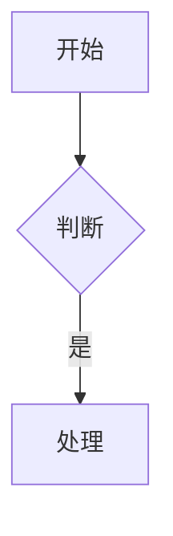
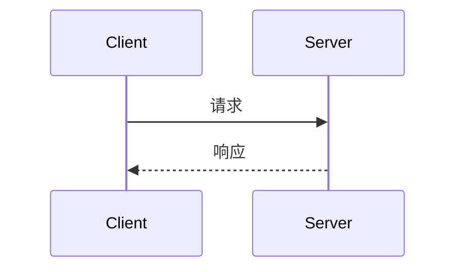
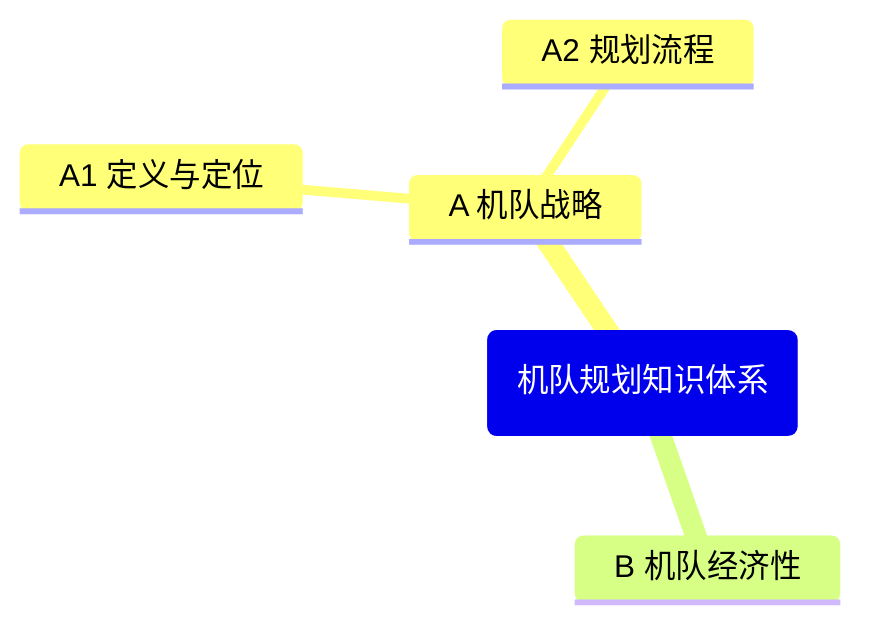

# fdiagram — 飞书画板统一入口

用飞书原生「画板」（whiteboard）出图。默认用飞书画板自带的 Mermaid 支持完成，**不手写 mermaid 代码**；仅当用户明确要求源码时才手动写并写入画板。

## 快速决策

```
用户意图
  ├─ 在飞书文档中加一张图（架构/流程/时序/ER/类/状态/甘特/饼/思维导图）→ 用飞书画板
  ├─ 用户明确给了 Mermaid/PlantUML 源码 → 写入飞书画板（+update --input_format）
  ├─ 已有画板需更新 → lark-cli whiteboard +update（见 lark-whiteboard skill）
  └─ 复杂视觉/自由布局/标注 → SVG 画板（whiteboard-cli）
```

默认路径：**在目标飞书文档中用 `<whiteboard type="mermaid">` 嵌入**，让飞书渲染白板。这是所有"在文档里放图"场景的标准答案。

## 默认用法：在飞书文档内嵌图（推荐）

在目标文档的 docs+update 内容里直接写：

```xml
<whiteboard type="mermaid">
flowchart TD
  A[机队战略] --> B[需求预测]
  B --> C[容量缺口]
</whiteboard>
```

- 飞书把 `<whiteboard type="mermaid">` 渲染为原生画板（底层 Mermaid/PlantUML，支持 flowchart / sequenceDiagram / erDiagram / classDiagram / stateDiagram / gantt / pie / mindmap）
- 与 ffeishu 协作：主文档正文由 ffeishu 维护，图块就地嵌入（禁止 ASCII 字符画、禁止 markdown 代码块、白板只能 `block_insert_after` 插入）
- 不需要额外装 npm 包（画板由飞书服务端渲染）；whiteboard-cli 仅 SVG 白板需要

## 手动写 Mermaid（仅用户明确要求源码时）

用户明确点明"给 mermaid 代码" / "mermaid 源码" 时，才手动编写 Mermaid 并交给画板。语法速查：

### Flowchart（架构/流程）

### SequenceDiagram（时序）

### Mindmap（思维导图 / 课程结构）

### 其他
erDiagram / classDiagram / stateDiagram-v2 / gantt / pie —— 语法见飞书白板支持列表。

## 已有画板更新

```bash
cat > diag.mmd <<'EOF'
graph TD
  A --> B
EOF
cd /tmp && lark-cli whiteboard +update --whiteboard-token <token> --input_format mermaid --source @./diag.mmd --overwrite --as user
```

> 完整命令/参数见 lark-whiteboard skill；`--overwrite` 才整板重建，省略为增量追加。

## SVG 白板（自由布局/手绘/标注，用 whiteboard-cli）

Mermaid 覆盖不了的自由布局、手绘风格、标注场景才用 SVG 画板：

```bash
npx -y @larksuite/whiteboard-cli@^0.2.11
```

SVG 白板详细规则 → [.whiteboard-rules.md](.whiteboard-rules.md)（形状语义、箭头、颜色、阴影约束）。

## 嵌入式画板的两种形态（都算"飞书画板"）

| 形态 | 何时用 | 命令 |
|------|--------|------|
| `<whiteboard type="mermaid">` 内嵌文档 | 在文档中配图、课程结构图、流程 | `docs +update / +create` XML 里直接写 |
| 独立画板 `lark-cli whiteboard +update` | 已有画板板更新、独立白板 | `whiteboard +update --input_format mermaid` |

> 底层是同一套飞书画板（Mermaid/PlantUML 渲染）。fdiagram 作为统一入口：用户描述要什么图 → fdiagram 默认用以上飞书画板路线完成；只有明确"我要 mermaid 源码"时手动写。

## 工具委托

| 操作 | 工具 | 说明 |
|------|------|------|
| 文档内嵌图 | ffeishu + `<whiteboard>` | 默认，飞书原生画板 |
| 独立画板更新 | lark-cli whiteboard +update | 已有画板 |
| SVG 自由布局 | whiteboard-cli | 仅自由布局/手绘场景 |
| 语法参考 | 本 skill + lark-whiteboard | 手动 mermaid 时 |